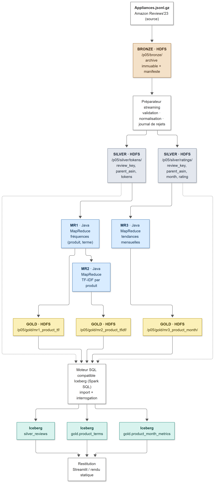

# Note de cadrage — P05 : Analyse distribuée des avis clients et des tendances

**ISIMa — Mastère 1 IA & DS — Big Data — 2026/2027**
**Groupe :** …………………… · **Livrable :** Semaine 1 · **Date :** 06/11/2026

---

## 1. Objectif et question d'ingénierie

Construire une chaîne **batch** sur Amazon Reviews'23 (catégorie *Appliances*) : trois jobs **Java Hadoop MapReduce** (MR1 fréquences lexicales, MR2 TF-IDF par produit, MR3 tendances mensuelles) dont les sorties sont publiées dans des tables **Apache Iceberg** (bronze/silver/gold), puis restituées dans une vue simple.

Question : *comment relier les thèmes récurrents des avis aux évolutions de notation par produit, avec des calculs distribués traçables ?*

Précaution scientifique : un terme à fort TF-IDF est un terme **caractéristique**, pas un sentiment. 1–2 / 3 / 4–5 étoiles = **polarité de notation**, pas vérité terrain textuelle.

## 2. Provenance et conditions d'usage

| Élément | Valeur |
|---|---|
| Jeu | Amazon Reviews'23, McAuley Lab (UC San Diego) |
| Référence scientifique | Hou et al., *Bridging Language and Items for Retrieval and Recommendation* (2024), arXiv 2403.03952 |
| Portail | https://amazon-reviews-2023.github.io/main.html |
| Avis (retenu) | `https://mcauleylab.ucsd.edu/public_datasets/data/amazon_2023/raw/review_categories/Appliances.jsonl.gz` |
| Métadonnées (facultatif) | `.../raw/meta_categories/meta_Appliances.jsonl.gz` |
| Volume annoncé | ≈ 2,1 M avis, ≈ 94 300 produits (valeurs du portail, avant filtrage) |
| Usage | Cadre pédagogique / recherche, dans le respect des conditions du diffuseur (portail ci-dessus). Pas de redistribution des données ; `user_id` jamais exposé. |

Le téléchargement est tracé dans un manifeste (`MANIFEST_download.json` : URL, date UTC, taille, SHA-256, test gzip).

## 3. Schéma attendu et audit

Champs utilisés (cdc §6.2) et risques :

| Champ | Usage | Risque / contrôle |
|---|---|---|
| `parent_asin` | clé produit (= « document » TF-IDF) | ne pas confondre avec `asin` ; rejet si absent |
| `rating` | MR3 | doit être dans [1,5] |
| `timestamp` | mois `YYYY-MM` | **millisecondes** (confirmé par l'audit : 2 128 604 / 2 128 605) |
| `title`, `text` | tokens MR1/MR2 | rejet si les deux sont vides |
| `verified_purchase`, `helpful_vote` | descriptifs facultatifs | non interprétés causalement |
| `user_id` | uniquement pour la clé technique de dédoublonnage | jamais affiché ni exporté en gold |

**Résultats de l'audit sur le fichier réel** (`Appliances.jsonl.gz`, audit complet, non partiel ; source : `reports/audit_schema.json`) :

| Mesure | Valeur |
|---|---|
| Lignes lues | 2 128 605 |
| Avis valides (avant déduplication) | 2 128 604 |
| Rejets par motif | 1 × `timestamp_unite_inconnue` (0,00005 %) ; 0 JSON invalide, 0 `parent_asin` absent, 0 note hors [1,5], 0 texte+titre vides |
| Complétude des champs | 10 champs présents à 100 % : `asin`, `parent_asin`, `user_id`, `title`, `text`, `rating`, `timestamp`, `helpful_vote`, `verified_purchase`, `images` (liste, non utilisée) |
| Types | `rating` = float ; `timestamp` = int ; `helpful_vote` = int (aucune valeur négative) ; `verified_purchase` = bool |
| Unité du timestamp | **millisecondes** pour 2 128 604 lignes (1 ligne d'unité non reconnue, voir point 2) |
| Plage de dates | 2002-11-17 → 2023-09-12 (UTC) |
| Produits distincts valides (`parent_asin`) | 94 318 (portail : ≈ 94 300) |
| Doublons (clé candidate `user_id｜parent_asin｜asin｜timestamp｜text`) | 22 657 (≈ 1,06 %) → avis uniques estimés : ≈ 2 105 947 |
| Distribution des notes | 1★ : 250 453 (11,8 %) · 2★ : 79 664 (3,7 %) · 3★ : 104 047 (4,9 %) · 4★ : 208 216 (9,8 %) · 5★ : 1 486 225 (69,8 %) |
| `verified_purchase` | vrai : 2 040 064 (95,8 %) · faux : 88 540 (4,2 %) |
| Longueur des textes (caractères) | moyenne 169,5 · médiane 88 · p95 580 · max 30 004 · `text` vide : 2 065 (≈ 0,1 %) |

**Lecture et décisions issues de l'audit**

1. **Timestamp = millisecondes** : la conversion en mois `YYYY-MM` se fait avec `ts / 1000`. Le test T05 doit utiliser des valeurs en ms.
2. **Une ligne au timestamp d'unité non reconnue** (ni millisecondes ni secondes plausibles) : elle est rejetée par la règle « date non décodable » et tracée dans le journal de rejets.
3. **Doublons ≈ 1 %** : déduplication obligatoire en S2 avec une clé technique stable ; la clé candidate ci-dessus est un point de départ (contrôle des collisions documenté).
4. **Notes très déséquilibrées** (≈ 70 % de 5★, 3★ minoritaires) : les profils mensuels de MR3 seront dominés par les hautes notes ; toute extension classifieur (§9.2 du cdc) exigera une baseline majoritaire et un traitement du déséquilibre. Ces notes restent des *indicateurs de notation*.
5. **Textes courts** (médiane 88 caractères, ≈ 0,1 % de `text` vide) : la règle « rejet si texte **et** titre vides » est retenue ; les avis à `text` vide mais titre non vide sont conservés pour la tokenisation ; leur nombre exact sera compté en S2. Les avis très courts rendent le seuil de 20 avis par produit d'autant plus nécessaire.
6. **Biais de corpus** : 95,8 % d'achats vérifiés ; période 2002–2023 inégalement couverte (couverture mensuelle à tracer).
7. Les 94 318 produits fixent l'ordre de grandeur de `N` (avant filtrage et dédoublonnage) ; `N` définitif sera calculé sur le corpus nettoyé.

Le script d'audit a été validé sur un jeu **jouet inventé** (`data/toy/`, tout est fictif, identifiants `TOY_*`) : 15 lignes → 12 valides, 3 rejets attendus (JSON invalide, `parent_asin` absent, note 7) — conforme au test T01.

## 4. Périmètre et échantillonnage (3 niveaux)

Population : *Appliances*, anglais uniquement. Le premier-N-lignes est **interdit** (biais d'ordre).

**Règle : échantillonnage par produit, déterministe.** `keep(p) ⇔ blake2b(sel | parent_asin) mod 10000 < taux × 10000`. On garde **tous** les avis des produits retenus, parce que le document TF-IDF est le produit entier : échantillonner des avis isolés fausserait TF et DF. La règle ne dépend ni de l'ordre des lignes ni de la machine ; sel et taux sont versionnés dans le manifeste.

| Niveau | Contenu | Usage |
|---|---|---|
| L0 — jouet | 12 avis inventés, 3 produits | tests exacts MR1/MR2/MR3 (S3–S4) |
| L1 — développement | 1 % des produits (`--rate 0.01`) : **912 produits, 20 346 avis** | développement, démos rapides |
| L2 — validation | 10 % des produits (`--rate 0.10`) : **9 431 produits, 207 351 avis** | mesures F10/T09, restitution |

Les taux sont ajustables selon les ressources disponibles. Pour chaque niveau, le manifeste associé consigne le taux de conservation, le nombre de produits et le nombre d'avis. La déduplication est réalisée en S2, pas à l'échantillonnage.

**Résultats des lots L1 et L2** (sel `p05-v1`, règle `blake2b(sel|parent_asin) mod 10000 < seuil`, avant déduplication ; 2 128 605 lignes lues, 0 ignorée) :

| Mesure | L1 (1 %) | L2 (10 %) |
|---|---|---|
| Seuil de la règle | < 100 | < 1000 |
| Produits retenus (sur 94 319 vus) | 912 (0,97 %) | 9 431 (10,00 %) |
| Avis retenus | 20 346 (0,96 %) | 207 351 (9,74 %) |
| Avis par produit (moyenne) | ≈ 22,3 | ≈ 22,0 |
| SHA-256 de l'échantillon | `48bfedf7…c443975` | `4c136ed8…135ca43c` |

Les taux de produits retenus sont proches des cibles (1 % et 10 %) ; la part d'avis diffère légèrement car les produits très évalués sont inégalement répartis entre les échantillons. Le nombre de produits vus (94 319) dépasse de 1 celui de l'audit (94 318), car l'échantillonneur compte aussi le produit de la ligne rejetée pour timestamp non reconnu, que l'audit exclut.

## 5. Choix méthodologiques figés dès maintenant

- **Document TF-IDF** = ensemble des avis nettoyés d'un `parent_asin`, identique dans MR1 et MR2.
- **Seuil d'interprétation :** 20 avis par produit (paramétrable, choix pédagogique, pas une contrainte du fournisseur).
- **N** (MR2) = nombre de produits ayant ≥ 1 document textuel valide, calculé et archivé dans un manifeste.
- **TF-IDF lissé :** `(1 + ln tf) × ln((N+1)/(df+1))`.
- **Motifs de rejet comptés :** JSON invalide, `parent_asin` absent, note hors [1,5] ou absente, timestamp invalide, texte et titre vides.
- **Règles NLP v0 (provisoires, finalisées en S2) :** minuscules ; Unicode NFKC ; tokens alphabétiques ; stop words anglais **hors négations** (`not`, `no`, `never`, `n't` conservés pour ne pas fermer l'option opinion) ; mots < 3 caractères exclus ; nombres retirés ; pas de lemmatisation en v0. Paramètres et listes versionnés.

## 6. Architecture cible (zones et chemins)

*Figure 1 — Flux des données. Traits pleins : flux principal ; pointillés : import des zones silver dans Iceberg.*

Principe : MapReduce **calcule**, le moteur SQL **charge et interroge** ; MapReduce n'écrit pas directement dans Iceberg. Sorties dans de nouveaux répertoires par identifiant de run, sans écrasement.

## 7. Justification : Lakehouse face à Lambda et Kappa

- **Besoin :** analytique **batch** sur historique figé, audit de provenance, aucune exigence de latence.
- **Lambda** ajoute une branche flux sans bénéfice ici et duplique la logique.
- **Kappa** impose un moteur continu (Kafka/Flink) pour un besoin qui n'est pas un flux ; MapReduce y serait difficile à justifier.
- **Lakehouse** : couches bronze/silver/gold sur HDFS avec tables transactionnelles Iceberg (schémas, snapshots, requêtes SQL reproductibles), MapReduce reste le moteur des calculs lourds. Compromis : intégration Hadoop/Iceberg à prouver tôt (démo de compatibilité en S2, versions figées).

## 8. Risques principaux (extrait du cdc §20)

| Risque | Mesure |
|---|---|
| Disque/RAM insuffisants | 3 niveaux d'échantillon, Hadoop pseudo-distribué |
| Unité de `timestamp` erronée | audit S1 sur valeurs réelles, test T05 |
| Produits peu évalués → TF-IDF instable | seuil de 20 avis, effectifs affichés |
| Interprétation abusive (négation, sarcasme) | vocabulaire « termes caractéristiques » |
| Skew de produits populaires | Combiner, profilage des clés |
| Compatibilité Hadoop/Iceberg | versions figées, test S2 |
| Données personnelles | `user_id` exclu de gold et de l'interface |

## 9. Plan de la Semaine 2

Installation de HDFS/YARN, dépôt de la zone bronze, préparateur streaming avec déduplication, règles NLP versionnées, démonstration de compatibilité Hadoop/Iceberg.

## 10. Livrables de la Semaine 1

- Scripts : téléchargement avec manifeste, audit de schéma, échantillonnage déterministe par produit.
- Jeu de contrôle fictif (L0) identifié comme test, avec lignes invalides (test T01).
- Audit complet du fichier réel (2 128 605 lignes) : rapport `audit_schema.json`.
- Présente note de cadrage.
